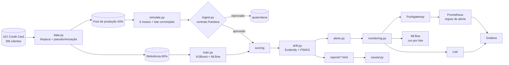
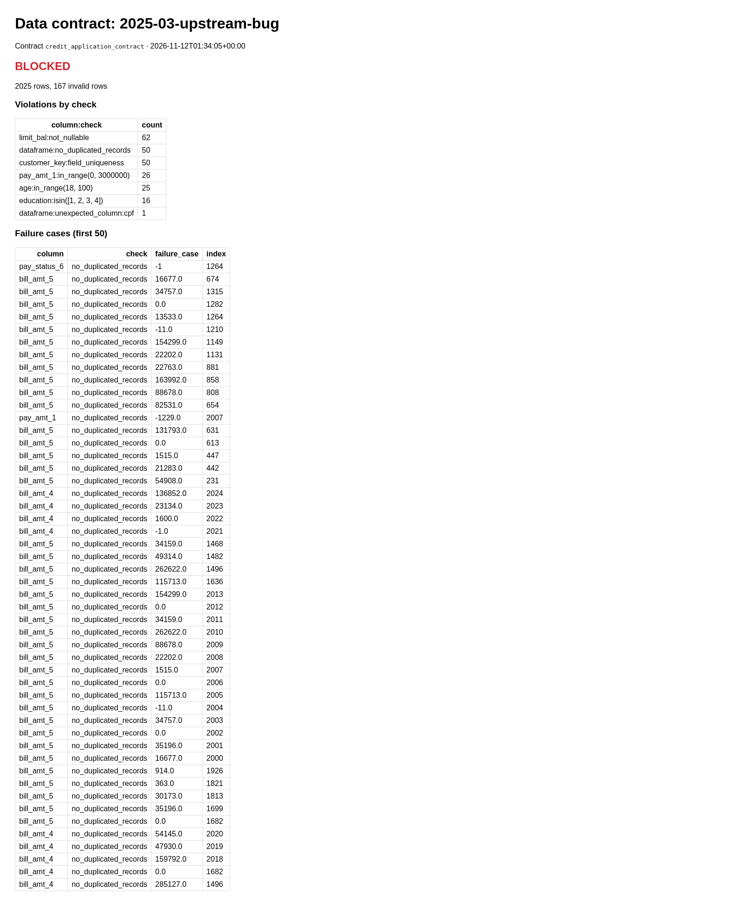
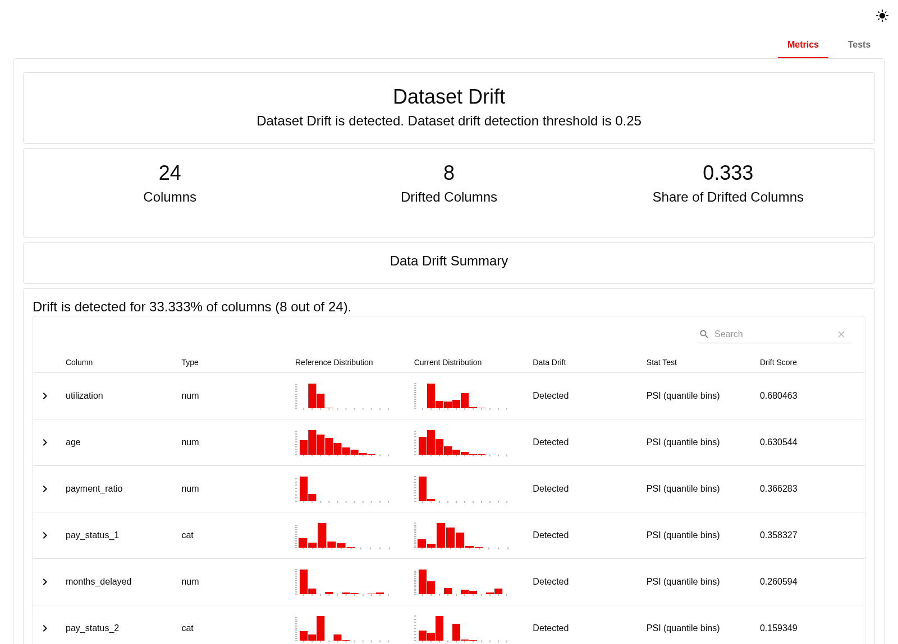
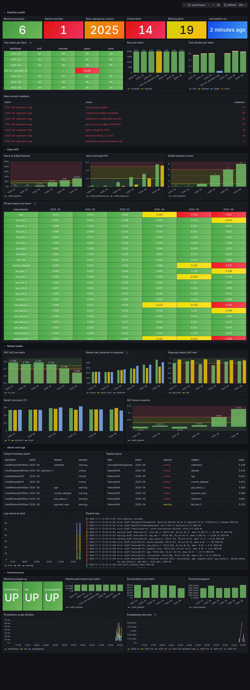
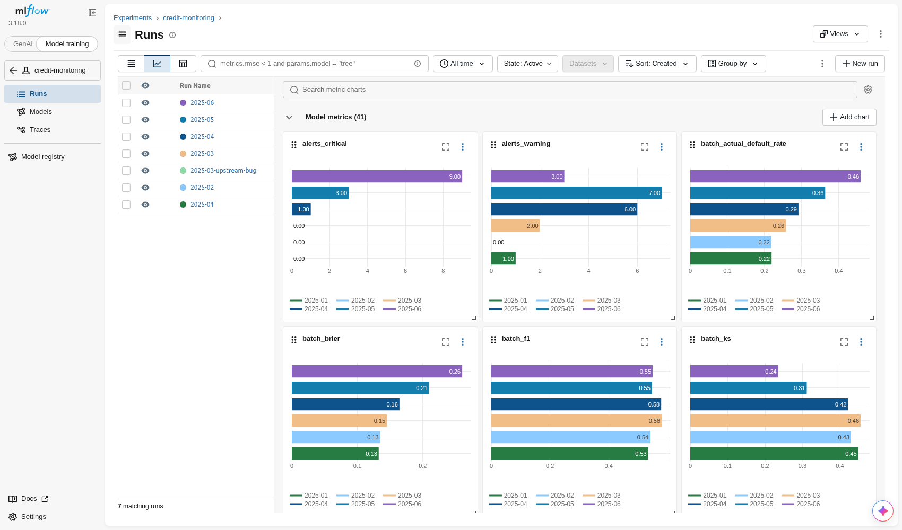
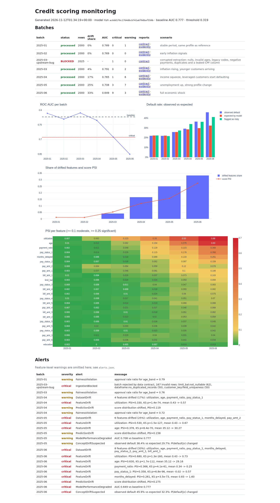
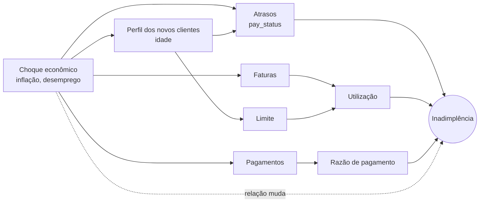
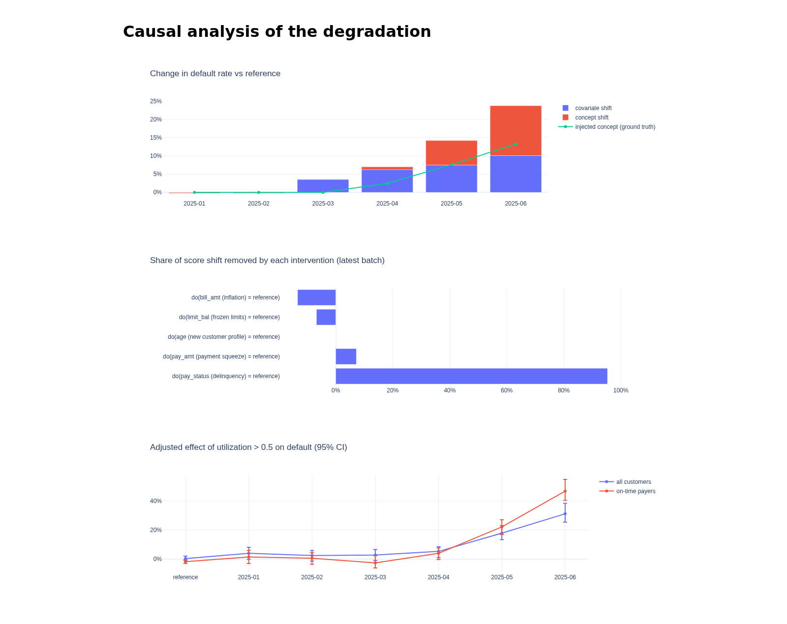

# Credit Scoring: Observabilidade, Drift e Governança

Tech Challenge – Fase 4 (MLET). Camada de **sustentação e confiabilidade** para um modelo de
credit scoring em produção: contratos de dados, simulação e detecção de *data drift* e
*concept drift*, observabilidade do pipeline e governança sob a LGPD, incluindo análise causal
da degradação.

> **Vídeo (STAR, 5 min):** _link a adicionar_

## Sumário

- [Contexto e resultado em uma frase](#contexto-e-resultado-em-uma-frase)
- [Arquitetura](#arquitetura)
- [Como executar](#como-executar)
- [Etapa 1 – Validação de dados e contratos](#etapa-1--validação-de-dados-e-contratos)
- [Etapa 2 – Simulação e detecção de drift](#etapa-2--simulação-e-detecção-de-drift)
- [Etapa 3 – Observabilidade de pipelines e modelos](#etapa-3--observabilidade-de-pipelines-e-modelos)
- [Etapa 4 – Governança e LGPD](#etapa-4--governança-e-lgpd)
- [Análise causal da degradação](#análise-causal-da-degradação)
- [Plano de ação](#plano-de-ação)
- [Lições aprendidas](#lições-aprendidas)

## Contexto e resultado em uma frase

Uma fintech suspeita que seu modelo de crédito degrada silenciosamente após choques econômicos.
Simulamos seis meses de produção com inflação, endividamento e mudança de perfil de clientes; o
pipeline **bloqueou um lote corrompido** (incluindo um vazamento de CPF), **detectou o drift
gradualmente sem falsos alarmes nos meses estáveis**, e a análise causal mostrou que **58% do
aumento da inadimplência no último mês é concept drift** — algo que retreinar com os mesmos
dados não resolveria.

## Arquitetura



| Camada | Ferramenta |
| --- | --- |
| Modelo | scikit-learn `Pipeline` + XGBoost |
| Contrato de dados | Pandera |
| Drift | Evidently 0.7 (com teste PSI por quantis registrado) + SciPy (KS) |
| Rastreamento | MLflow (registry do modelo + um run por lote) |
| Métricas e alertas | prometheus-client → Pushgateway → Prometheus (regras) |
| Logs | JSON estruturado → arquivo + Loki |
| Dashboards | Grafana (provisionado) e relatório HTML estático |
| CI | GitHub Actions (lint, testes e gate do contrato) |

## Como executar

Pré-requisitos: [uv](https://docs.astral.sh/uv/) e Docker (opcional, só para a stack de
observabilidade). O dataset já está em `data/UCI_Credit_Card.csv`.

```bash
make setup        # instala dependências
make up           # Prometheus, Pushgateway, Loki e Grafana (opcional)
make all          # data -> train -> simulate -> pipeline -> dashboard -> causal
make test         # 20 testes
```

| Serviço | Endereço |
| --- | --- |
| Grafana (dashboard "Credit Scoring - Monitoring") | http://localhost:3000 (admin/admin) |
| Prometheus (regras em `/alerts`) | http://localhost:9090 |
| MLflow (`make mlflow-ui`) | http://localhost:5000 |

Sem Docker o pipeline roda normalmente: métricas ficam em `reports/metrics/*.prom` e os logs
em `logs/pipeline.jsonl`.

Comandos individuais:

```bash
make validate BATCH=data/batches/2025-03-upstream-bug.csv   # exit code 1, lote bloqueado
make train
make pipeline
```

### Estrutura

```
src/credit_scoring_drift/
  config.py      caminhos, colunas, features do modelo e monitoradas
  data.py        limpeza, pseudonimização e split referência/produção
  contracts.py   contrato Pandera
  ingest.py      gate de ingestão, quarentena e relatório de qualidade
  features.py    features derivadas (utilização, razão de pagamento, meses em atraso)
  train.py       baseline, threshold, auditoria de fairness, MLflow
  simulate.py    cenários de produção e lote corrompido
  drift.py       Evidently + PSI/KS
  alerts.py      regras de alerta
  monitoring.py  logs JSON/Loki e métricas Prometheus
  pipeline.py    orquestração por lote
  dashboard.py   relatório HTML estático
  causal.py      decomposição, intervenções e g-computation
monitoring/      configuração de Prometheus, Grafana e regras de alerta
reports/         evidências geradas (HTML, JSON, métricas)
tests/           testes de contrato, drift, alertas e monitoramento
```

## Etapa 1 – Validação de dados e contratos

**Dataset:** [Default of Credit Card Clients (UCI)](https://archive.ics.uci.edu/dataset/350),
30.000 clientes, alvo `default` (inadimplência no mês seguinte, 22,1%).

**Limpeza** (`data.py`): códigos não documentados de `education` (0, 5, 6) e `marriage` (0)
viram "outros"; 35 registros duplicados (mesmas features, IDs diferentes) são removidos; o `ID`
é substituído por um hash SHA-256 com salt (`customer_key`).

**Separação referência × produção:** split estratificado 60/40 com seed fixa. A referência
(17.979 linhas) é a única usada para treino; o pool de produção (11.986 linhas) só alimenta a
simulação. Dentro da referência, 25% ficam como holdout — é contra ele (com scores fora da
amostra) que o drift é medido.

**Modelo baseline** (`train.py`): XGBoost em `Pipeline` do scikit-learn com as features
derivadas embutidas, threshold escolhido por F1 em predições *out-of-fold*, registrado no MLflow
como `credit-scoring-xgb`.

| ROC AUC | KS | F1 | Precisão | Recall | Brier |
| --- | --- | --- | --- | --- | --- |
| 0.777 | 0.433 | 0.537 | 0.547 | 0.528 | 0.137 |

### Contrato (`contracts.py`)

Schema Pandera `strict` com `coerce`, validado em modo `lazy` (todas as violações são
coletadas antes de decidir):

| Regra | Tipo |
| --- | --- |
| `customer_key` não nulo, único e no formato de hash (16 hex) | coluna |
| `limit_bal` não nulo e entre 1 e 1.000.000 | coluna |
| `age` entre 18 e 100 | coluna |
| `sex` ∈ {1,2}, `education` ∈ {1..4}, `marriage` ∈ {1,2,3} | coluna |
| `pay_status_*` ∈ {-2..8} | coluna |
| `pay_amt_*` ≥ 0; `bill_amt_*` dentro de limites plausíveis; sem nulos | coluna |
| `default` ∈ {0,1} | coluna |
| nenhum registro duplicado | dataframe |
| lote com pelo menos 100 linhas | dataframe |
| nenhuma coluna fora do schema (`strict`) | dataframe |

A regra `strict` também é um controle de privacidade: se a extração passar a trazer um campo
novo (como um CPF), o lote é barrado antes de qualquer processamento.

### Lote corrompido sendo bloqueado

`simulate.py` gera `2025-03-upstream-bug.csv`, simulando uma falha na extração. O gate
(`ingest.py`) reprova o lote, copia o arquivo para `data/quarantine/<lote>/` junto com
`failure_cases.csv`, gera `reports/quality/<lote>.html|json`, emite log de erro e alerta
`IngestionBlocked`; o lote corrigido do mesmo mês segue normalmente.

| Violação | Linhas |
| --- | --- |
| `limit_bal` nulo | 62 |
| registros duplicados | 50 |
| `customer_key` repetido | 50 |
| `pay_amt_1` negativo | 26 |
| idade fora de 18–100 (0, 15, 17) | 25 |
| `education` com código legado 0 | 16 |
| coluna inesperada `cpf` | 1 |



O CI executa o mesmo gate: o job `contract-gate` falha se o lote limpo for reprovado ou se o
corrompido passar.

## Etapa 2 – Simulação e detecção de drift

### Cenário simulado

Seis lotes mensais de 2.000 clientes, com intensidade crescente `t`:

| Mês | t | Cenário |
| --- | --- | --- |
| 2025-01 | 0.00 | estável, mesmo perfil da referência (controle de falso alarme) |
| 2025-02 | 0.10 | primeiros sinais de inflação |
| 2025-03 | 0.30 | inflação subindo, clientes mais jovens chegando |
| 2025-04 | 0.50 | aperto de renda; concept drift começa |
| 2025-05 | 0.75 | desemprego e mudança forte de perfil |
| 2025-06 | 1.00 | choque econômico completo |

Mecanismos (`simulate.py`):

1. **Covariate shift (data drift):** reamostragem ponderada do pool favorecendo clientes jovens
   e já em atraso. Como só muda *quem* chega, preserva P(default | x).
2. **Choque econômico:** faturas e pagamentos inflacionam até 60% com limites congelados
   (utilização sobe), e uma fração crescente de clientes passa a pagar metade do que pagava.
3. **Concept drift:** clientes **adimplentes e alavancados** (utilização > 50%, sem atraso)
   passam a inadimplir com probabilidade crescente — um padrão que a referência nunca mostrou.
   A inadimplência injetada é registrada em `manifest.json` como *ground truth*.

### Detecção

`drift.py` compara cada lote com a referência em 24 variáveis (as 21 features do modelo, `age`
e as 3 derivadas):

- **PSI** com bins por quantis da referência (variáveis discretas usam as categorias);
- **Kolmogorov–Smirnov** (SciPy);
- uma feature é considerada com drift quando **PSI ≥ 0,1 e p-valor KS < 0,01** — exigir os dois
  evita falsos positivos do KS com amostras grandes;
- **Evidently** (`DataDriftPreset` + `ClassificationPreset`) gera o relatório HTML por lote.

> O PSI nativo do Evidently usa bins de largura fixa, o que esconde deslocamentos em variáveis
> monetárias de cauda longa (`pay_amt_1` em 2025-06: 0,003 no Evidently contra 0,106 com quantis).
> Registramos um `StatTest` próprio (`quantile_psi`) no Evidently para que o relatório HTML e
> a tabela estatística usem exatamente a mesma medida.

### Resultados

| Lote | Features com drift | PSI do score | AUC | Inadimplência observada | Esperada pelo modelo |
| --- | --- | --- | --- | --- | --- |
| referência | – | – | 0.777 | 22,1% | 22,1% |
| 2025-01 | 0 | 0,01 | 0.789 | 21,9% | 22,2% |
| 2025-02 | 0 | 0,01 | 0.769 | 21,8% | 22,1% |
| 2025-03 | 1 (`utilization`) | 0,05 | 0.791 | 25,8% | 25,8% |
| 2025-04 | 4 | 0,12 | 0.765 | 29,1% | 28,5% |
| 2025-05 | 6 | 0,16 | 0.708 | 36,3% | 29,7% |
| 2025-06 | 8 (33%) | 0,27 | 0.649 | 45,9% | 32,3% |

Variáveis degradadas em 2025-06 (PSI): `utilization` 0,68 · `age` 0,63 · `payment_ratio`
0,37 · `pay_status_1` 0,36 · `months_delayed` 0,26 · `pay_status_2` 0,16 · `pay_amt_1` 0,11 ·
`bill_amt_1` 0,10.

Leitura:

- **Sem falsos alarmes** nos meses estáveis (01 e 02).
- **Degradação silenciosa em 2025-03:** só a utilização deriva e a AUC continua boa — é o
  alerta antecipado que permitiria agir antes do prejuízo.
- As faturas brutas (`bill_amt_*`) quase não derivam (PSI < 0,1 até o fim), porque os novos
  clientes jovens têm faturas menores e isso compensa a inflação. **A inflação só aparece na
  feature derivada** (`utilization`), por isso monitoramos também as features construídas.
- A partir de 2025-05 a inadimplência observada descola da esperada: o modelo continua
  calibrado para o mundo antigo.

Evidências: `reports/drift/<lote>.html` (Evidently), `<lote>_stats.csv` (PSI/KS por feature) e
`<lote>.json`.



## Etapa 3 – Observabilidade de pipelines e modelos

Cada lote passa pelas tarefas `ingest → score → drift → evaluate`, cada uma instrumentada com
status e duração. Ao final do lote:

- **Métricas** vão para o Pushgateway (agrupadas por `batch`) e para `reports/metrics/<lote>.prom`;
- **Logs JSON** vão para `logs/pipeline.jsonl` e para o Loki;
- um **run no MLflow** (experimento `credit-monitoring`) recebe métricas de drift e performance,
  o HTML do Evidently, o relatório do contrato e os alertas;
- `reports/pipeline_summary.json` e `reports/alerts.json` consolidam tudo e alimentam o relatório
  estático `reports/monitoring_dashboard.html`.

### Métricas de saúde

| Métrica | Significado |
| --- | --- |
| `credit_pipeline_task_success{task}` | 1 se a tarefa concluiu, 0 se falhou |
| `credit_pipeline_task_duration_seconds{task}` | latência de cada etapa |
| `credit_pipeline_batch_status` | 1 aceito, 0 bloqueado pelo contrato |
| `credit_pipeline_rows{stage}` | volume recebido / aceito / rejeitado |
| `credit_contract_violations{check}` | violações por regra |
| `credit_drift_share`, `credit_drifted_features` | proporção e número de features com drift |
| `credit_feature_psi{feature}`, `credit_feature_ks_statistic{feature}` | estatísticas por feature |
| `credit_prediction_psi`, `credit_target_psi` | drift do score e do alvo |
| `credit_model_metric{metric}`, `credit_model_auc_drop` | AUC, KS, F1, precisão, recall, Brier e queda vs baseline |
| `credit_default_rate{kind}` | inadimplência observada × esperada × prevista |
| `credit_fairness_disparate_impact{attribute}` | razão de aprovação entre grupos |
| `credit_inference_latency_seconds`, `credit_inference_rows_per_second` | desempenho do scoring |
| `credit_alerts{severity}`, `credit_alert_active{alert,severity,subject}` | alertas do lote |
| `process_*` | memória e CPU do processo do pipeline |
| `up`, `scrape_duration_seconds`, `push_time_seconds` | saúde da própria stack |

Métricas sem rótulo só são exportadas quando medidas — um lote bloqueado não publica
`credit_drift_share = 0` como se não houvesse drift.

### Alertas

As mesmas regras existem no Python (`alerts.py`, usadas nos logs, MLflow e relatórios) e no
Prometheus (`monitoring/prometheus/alerts.yml`).

| Alerta | Condição | Severidade |
| --- | --- | --- |
| `IngestionBlocked` | contrato reprovado | crítico |
| `DatasetDrift` | ≥ 15% das features com drift / ≥ 25% | aviso / crítico |
| `FeatureDrift` | PSI ≥ 0,1 e KS p < 0,01 / PSI ≥ 0,25 | aviso / crítico |
| `PredictionDrift` | PSI do score ≥ 0,1 / ≥ 0,25 | aviso / crítico |
| `ModelPerformanceDegraded` | queda de AUC ≥ 0,03 / ≥ 0,07 | aviso / crítico |
| `ConceptDriftSuspected` | inadimplência observada − esperada ≥ 5 p.p. / ≥ 10 p.p. | aviso / crítico |
| `FairnessViolation` | razão de aprovação < 0,8 (regra dos 4/5) | aviso |
| `CreditPipelineTaskFailed`, `MonitoringTargetDown` | falha de tarefa / alvo fora do ar | crítico |

Alertas gerados na execução: 14 críticos e 19 avisos, concentrados de 2025-04 em diante.

### Dashboard Grafana

Provisionado automaticamente (`monitoring/grafana`), com seções de saúde do pipeline, drift,
saúde do modelo, alertas e logs (Loki) e infraestrutura.



### MLflow

Modelo registrado com assinatura, métricas, auditoria de fairness e importância de features
(experimento `credit-scoring-baseline`), e um run por lote em `credit-monitoring`, o que permite
comparar os meses lado a lado.



### Relatório estático

Para quem não roda Docker: `reports/monitoring_dashboard.html`.



## Etapa 4 – Governança e LGPD

### Inventário de dados

| Dado | Classificação LGPD | Uso no projeto |
| --- | --- | --- |
| `ID` do cliente | dado pessoal (identificador) | substituído por pseudônimo; nunca sai de `data.py` |
| `sex` | dado pessoal com alto risco discriminatório | **fora do modelo**; usado só na auditoria de fairness |
| `marriage` | dado pessoal | **fora do modelo**; não utilizado |
| `age` | dado pessoal | **fora do modelo** (ver mitigação de vieses); monitorado para drift e fairness |
| `education` | dado pessoal | usado no modelo; monitorado |
| limite, faturas, pagamentos, atrasos | dados financeiros pessoais | features do modelo |
| `default` | dado pessoal (resultado de crédito) | alvo de treino e avaliação |
| CPF | identificador direto | **não deve existir** no pipeline; o contrato bloqueia o lote se aparecer |

Nenhum dado sensível do art. 5º, II (origem racial, saúde, religião, biometria etc.) é
tratado. O dataset é público (UCI, CC BY 4.0) e já anonimizado na origem; mesmo assim aplicamos
os controles como se fossem dados reais de clientes.

### Privacy by design e by default

- **Pseudonimização:** `customer_key = SHA-256(salt + ID)` truncado. O salt vem da variável
  de ambiente `PSEUDO_SALT` e, em produção, ficaria num cofre de segredos, separado dos dados
  (art. 13, §4º).
- **Minimização (art. 6º, III):** o modelo usa apenas as variáveis necessárias para avaliar o
  risco; sexo, estado civil e idade não entram na decisão.
- **Barreira na entrada:** o contrato `strict` rejeita colunas não previstas, impedindo que um
  identificador direto contamine logs, métricas ou o modelo.
- **Logs e métricas sem dados pessoais:** registram apenas agregados (contagens, PSI, AUC) e o
  identificador do lote, nunca registros individuais.
- **Quarentena com acesso restrito:** os lotes reprovados ficam isolados para análise do time de
  dados e são descartados após a correção (ver retenção).
- **Controle de versão:** `data/processed`, `data/quarantine`, `models/` e `logs/` estão no
  `.gitignore`; somente o dataset público e relatórios agregados são versionados.

### Base legal

| Tratamento | Base legal |
| --- | --- |
| Avaliação de risco e decisão de concessão | **art. 7º, X – proteção do crédito**, com amparo na Lei 12.414/2011 (Cadastro Positivo) |
| Uso dos dados de relacionamento para cobrança e gestão do contrato | art. 7º, V – execução de contrato |
| Monitoramento, auditoria de fairness e retenção de evidências | art. 7º, IX – legítimo interesse (avaliado em LIA) e art. 7º, II – obrigação regulatória (Res. CMN 4.557/2017, gestão de riscos) |

**Decisões automatizadas (art. 20):** o titular pode solicitar a revisão da decisão. O processo
prevê revisão humana pela mesa de crédito, explicação dos principais fatores da decisão (a
importância das features está registrada no MLflow; as principais são histórico de atrasos e
utilização) e a garantia de que nenhum atributo protegido foi usado.

### Direitos dos titulares (art. 18)

Acesso, correção, anonimização e eliminação são atendidos pela chave pseudonimizada: o
controlador recalcula `customer_key` a partir do ID informado e localiza os registros sem que o
identificador original circule pelo pipeline. A eliminação respeita os prazos legais de guarda
da tabela abaixo.

### Plano de retenção

| Artefato | Retenção | Justificativa |
| --- | --- | --- |
| Dados brutos de clientes | duração do contrato + 5 anos | prescrição da cobrança (Código Civil, art. 206, §5º, I) e limite de 5 anos para informações negativas (CDC, art. 43, §1º) |
| Dataset de referência (treino) | enquanto o modelo estiver ativo + 5 anos | auditoria e reprodutibilidade |
| Lotes de produção pseudonimizados | 24 meses | análises de drift e retreino |
| Lotes em quarentena | 30 dias após a correção | apenas diagnóstico |
| Logs do pipeline | 12 meses | operação e investigação de incidentes |
| Métricas (Prometheus) | 15 dias (configurado); agregados no MLflow por tempo indeterminado | séries operacionais × histórico do modelo |
| Relatórios de drift e fairness | por tempo indeterminado | contêm apenas agregados, evidência de governança |

Ao final do prazo, os dados são eliminados ou anonimizados de forma irreversível (descarte do
salt).

### Mitigação de vieses

A auditoria de fairness roda no treino e em cada lote (razão de aprovação entre grupos, com a
regra dos 4/5 como limite):

| Versão do modelo | AUC | Impacto desigual por sexo | Impacto desigual por faixa etária |
| --- | --- | --- | --- |
| com `age` | 0.778 | 0.94 | **0.77** (reprovado) |
| sem `age` (adotado) | 0.777 | 0.93 | 0.86 |

A primeira versão reprovava clientes de 60+ e de 18–25 anos com frequência
desproporcional. Retirar `age` custou 0,001 de AUC e resolveu a violação; a idade continua sendo
**monitorada** (ela explica boa parte do drift populacional) mas não participa da decisão.

Em produção, o alerta `FairnessViolation` ainda dispara em 2025-01, 03 e 04 (0,72 a 0,79). Duas
causas, ambas documentadas: (1) o grupo 60+ tem só ~30 clientes por lote, então a métrica é
ruidosa; (2) proxies indiretos — clientes jovens têm mais atrasos. O procedimento definido é
revisão humana do alerta, acompanhamento do intervalo de confiança da métrica e, se persistir,
ajuste de threshold por grupo ou reponderação no retreino.

### Segurança e responsabilidades

- Credenciais (salt, senha do Grafana) via variáveis de ambiente, nunca no código.
- Grafana com acesso anônimo apenas para leitura; MLflow e Prometheus ficariam atrás de VPN/SSO
  em produção.
- Incidentes envolvendo dados pessoais seguem o fluxo de comunicação à ANPD e aos titulares
  (art. 48).
- Papéis: o time de dados é responsável pelo pipeline e pelo contrato; o time de risco pela
  política de crédito e revisão humana; o DPO pelo RIPD (art. 38) e pelo atendimento aos
  titulares.

## Análise causal da degradação

A pergunta da diretoria é *por que* o modelo piorou e o que fazer. Drift estatístico mostra
**o que mudou**, não **o que causou** a perda. Usamos o seguinte DAG:



`causal.py` responde em três passos (`reports/causal/`):

**1. Decomposição da mudança na inadimplência.** O modelo treinado na referência estima
P_ref(default | x). Aplicado aos clientes de cada mês (com correção de calibração), ele diz qual
seria a inadimplência *se só a população tivesse mudado*. O restante é concept drift.

| Lote | Variação observada | Por mudança de população | Por mudança de relação | Injetado (verdade) |
| --- | --- | --- | --- | --- |
| 2025-03 | +3,6 p.p. | +3,6 | +0,1 | 0 |
| 2025-04 | +7,0 p.p. | +6,3 | +0,8 | +2,5 |
| 2025-05 | +14,2 p.p. | +7,5 | +6,7 | +7,6 |
| 2025-06 | +23,8 p.p. | +10,1 | **+13,7** | +13,3 |

A estimativa recupera o concept drift injetado com erro < 1 p.p. em 2025-05 e 2025-06. Em
2025-06, **58% da piora não é explicada pela mudança de perfil**.

**2. Intervenções (*do*-operator) no lote 2025-06.** Substituímos a distribuição de cada grupo
de variáveis pela da referência (mapeamento por quantis, que preserva a ordem dos clientes) e
medimos quanto do aumento do score desaparece:

| Intervenção | Parcela do deslocamento do score removida |
| --- | --- |
| do(pay_status = referência) | **95%** |
| do(pay_amt = referência) | 7% |
| do(age = referência) | 0% (idade não está no modelo) |
| do(limit_bal = referência) | −7% |
| do(bill_amt = referência) | −13% |

O score sobe quase só por causa do aumento de atrasos. Faturas inflacionadas *reduzem* o score
do modelo (aprendeu que fatura alta é cliente com mais renda) — exatamente o comportamento que
fica errado num cenário inflacionário.

**3. Efeito ajustado da utilização (g-computation).** Estimamos o efeito de ter utilização
> 50% sobre a inadimplência, ajustando pelos confundidores do DAG (idade, limite, atrasos,
educação), com IC 95% por bootstrap:

| Base | Todos os clientes | Clientes adimplentes |
| --- | --- | --- |
| Referência | +0,4 p.p. [−0,9; 2,1] | −1,7 p.p. [−2,9; −0,4] |
| 2025-04 | +5,3 p.p. [1,1; 8,6] | +4,1 p.p. [−0,2; 7,7] |
| 2025-05 | +17,9 p.p. [13,4; 23,1] | +22,1 p.p. [16,9; 27,0] |
| 2025-06 | **+31,1 p.p.** [25,4; 38,3] | **+46,6 p.p.** [40,3; 54,6] |

Antes do choque, alta utilização **não causava** inadimplência entre bons pagadores; depois,
eleva a probabilidade em 47 p.p. A relação causal mudou — é por isso que a AUC cai: o modelo
continua classificando como seguros os clientes alavancados que nunca atrasaram.



**Limitações:** identificação depende do DAG (sem confundidores não observados como renda, que
o dataset não traz); a decomposição assume o modelo bem calibrado na referência (Brier 0,137;
score médio 22,3% contra inadimplência observada de 22,1%); os dados de produção são simulados.

## Plano de ação

1. **Imediato (alerta crítico):** reduzir exposição — revisão humana obrigatória para clientes
   com utilização > 50%, ainda que sem atrasos, e corte de limites novos até o retreino.
2. **Curto prazo:** recalibrar o modelo com os rótulos recentes (corrige o descolamento entre
   inadimplência observada e esperada) e retreinar com janela que inclua o período de choque.
3. **Estrutural:** incluir variáveis macroeconômicas (inflação, desemprego) e renda, cuja ausência
   torna o modelo cego à mudança de contexto; adotar features em termos reais (deflacionadas).
4. **Gatilhos de retreino:** `ConceptDriftSuspected` crítico, `ModelPerformanceDegraded`
   crítico ou `DatasetDrift` crítico por dois lotes seguidos.

## Lições aprendidas

- **Drift de dados não é perda de performance.** Em 2025-03 houve drift e a AUC não caiu; em
  2025-05 a queda veio junto com concept drift. Monitorar só as features gera alarmes sem
  impacto ou deixa passar o que importa.
- **Monitorar features derivadas.** A inflação só ficou visível na utilização.
- **A escolha do teste importa.** PSI com bins de largura fixa (padrão do Evidently) não
  detectou drift em variáveis monetárias; com quantis, detectou.
- **Combinar testes evita falsos positivos.** Com milhares de linhas o KS acusa diferenças
  irrelevantes; exigir também PSI ≥ 0,1 manteve os meses estáveis sem alertas.
- **Rótulos chegam atrasados.** A diferença entre inadimplência observada e esperada é o
  sinal mais direto de concept drift, mas só existe quando o rótulo chega; até lá, o drift de
  features e do score funciona como alerta antecipado.
- **Governança muda o modelo.** A auditoria de fairness tirou a idade do modelo a um custo
  desprezível de AUC.
